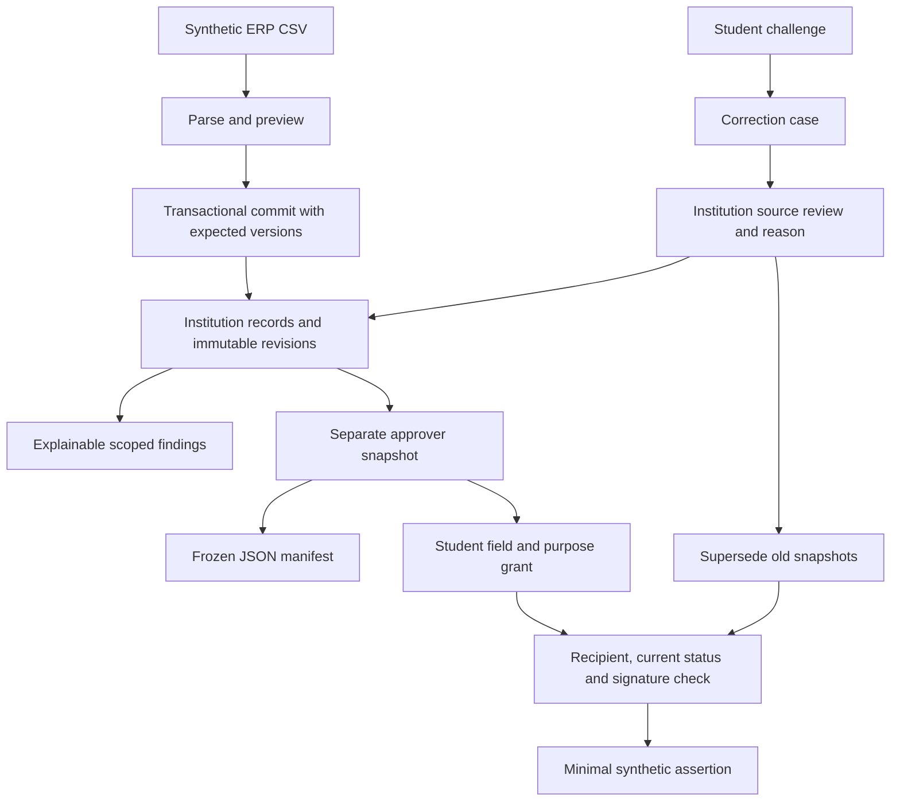

# Prototype decisions and scope

28 October 2026. The user explicitly moved the project from research into a local initial prototype. The research repository is a reference; historical read-only prompts in imported material do not override this request.

## Deliberate small stack

React/TypeScript/Vite serves the interface; Express validates local API actions; Node 24's SQLite module persists records and audit data. This saves infrastructure setup time while implementing real behavior. Zod validates contracts; csv-parse handles quoted CSV; Node crypto provides a synthetic Ed25519 issuer. The locally bundled font and icons avoid runtime CDN dependence.

## Data flow

Records belong to a tenant. A student session is bound to one local record; a recipient session is bound to one fictional verifier. Sessions are server-side demo objects identified by HttpOnly/SameSite cookies. Mutation tokens and local-origin checks reduce accidental cross-site actions. The persona selector deliberately lets a judge choose these simulated identities, so none of this substitutes for production authentication.

CSV staging is separate from commit. Each staged job retains its source fingerprint. Commit checks the live versions again inside one SQLite transaction; a conflict rolls back all changes. A repeated committed batch returns the original receipt. Every actual source change supersedes prior approved snapshots.

Approval freezes rows, versions, findings, a rule-pack identifier and a digest. The digest is reproducibility evidence, not proof that the reported facts are true. A student grant is bound to a record revision and approved snapshot. Verification checks live permission and expiry, intended recipient, current revision/snapshot and signature. Revoked, expired or superseded requests return no claims.

## Required vs demonstrated

| Research requirement | Initial prototype |
|---|---|
| Upload and update | Real scoped CSV staging, commit, replay and revisions |
| Intake and categories | Two fictional programmes, explicit capacities and regular-entry fixture; full legal seat/category model deferred |
| Validation | Input shape, capacity arithmetic, missing evidence and source disagreement; no automated sanction |
| Dashboards | Institution records/findings and fictional regulator aggregates |
| Authorised verification | Implemented demo recipient grant, expiry, withdrawal and signed minimal claims |
| Verifiable records | Synthetic issuer/signature plus current source status; no official award |
| Interoperability | CSV/internal API only; provider fixtures labelled throughout |
| Privacy/roles/audit | Server checks and local revision/audit chain; real OIDC/KMS/assessment deferred |
| Reports | Tenant summary, retained audit verification, frozen JSON and minimal CSV; no official report schema asserted |
| Certificate printing | Deferred to an authorised awarding-body workflow |

## Next pilot changes

Move durable storage to PostgreSQL with proper tenant-role configuration; replace persona selection with institutional OIDC and vetted recipients; protect keys in managed custody; approve exact policy/data-purpose/retention scope; obtain provider permission and test documented account-linked contracts; test concurrency, recovery and security; compare real user work with the existing reporting workflow.

No statistical fraud model, LLM adjudicator, cross-institution search, blockchain or national-scale infrastructure is needed to explain the first prototype.

## Submission backend upgrade — version 0.2.0

The application uses small dedicated modules for configuration, HTTP boundaries, database schema, CSV processing, signing and audit inspection. Shared student/import types avoid a frontend dependency on server implementation code. The root npm workspace provides a single pinned lockfile and the same commands locally and in CI.

SQLite enables WAL, foreign keys and a busy timeout. Schema version 1 adds tenant-consistent references, source/JSON consistency, unique open cases, unique committed fingerprints and one current approved snapshot per tenant. Triggers guard revisions, audit rows and frozen snapshot/grant data against ordinary application changes. An explicit reset flag permits the synthetic reset transaction. A legacy unversioned database is refused instead of silently migrated; use a fresh DATA_DIR and retain the old baseline separately.

Sessions persist as token hashes with a one-hour expiry and an active-session bound. Local startup refuses non-loopback binds. Explicit hosted demo mode requires a judge code and exact host/origin settings; DEMO_MODE=false fails closed until a real identity adapter is supplied. Request limits, payload bounds, local Host/Origin checks, structured errors and security headers reduce accidental or malformed demo requests. They do not turn selectable personas into real authentication.

Import commit acquires a write transaction before reading the staged job and canonical receipt. It checks every previewed source version before skipping unchanged rows. Corrections, approval and verification decisions also use transactions. Signature validation binds the fixed algorithm and key ID to issuer, recipient, purpose, grant reference, exact field set, expiry, source version and current snapshot. Verification remains an online service decision; a downloaded signature is not an independently current official credential.

Reports use current tenant arithmetic; JSON/CSV exports retain exact approved rows and current approval status. CSV omits APAAR and neutralises spreadsheet formula prefixes. Audit inspection recomputes each institution's retained chain. Neither hashing nor immutable application guards defeat a privileged administrator replacing all local evidence.

[Implemented API](../../docs/API.md) and [executed tests](../../docs/TESTING.md) define the current boundary. PostgreSQL, external audit anchoring, managed keys and real authentication remain pilot changes.

Approval now checks a digest over the reviewed records, findings and cases inside its transaction. A stale open case can be superseded by a linked request against the current source revision; both cases remain in history. The [hosting guide](../../docs/DEPLOYMENT.md) describes the optional Vercel-to-Render topology.
